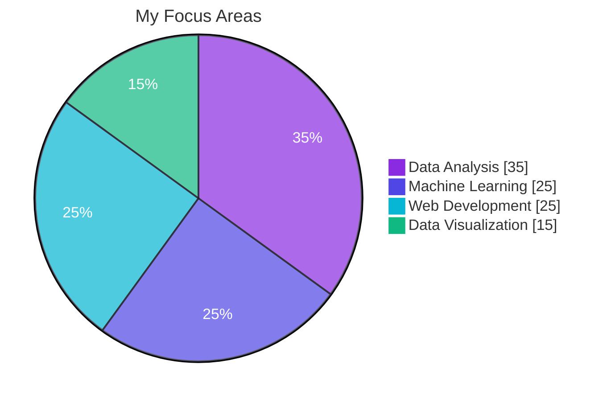
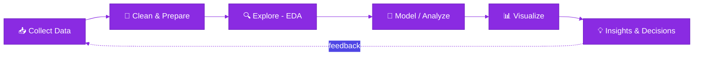
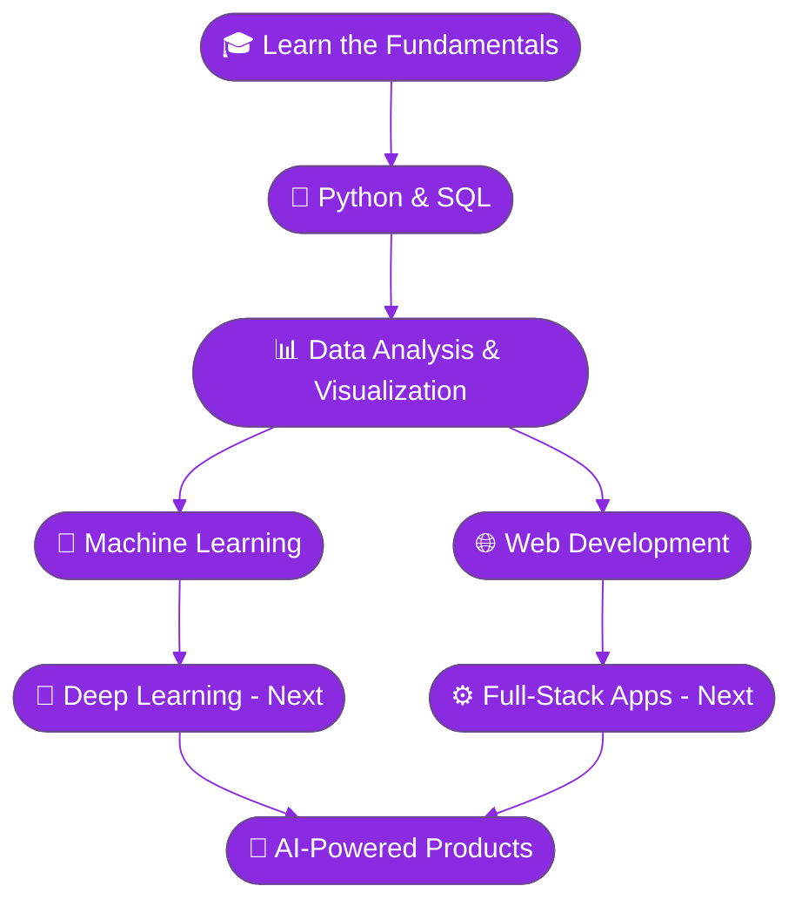
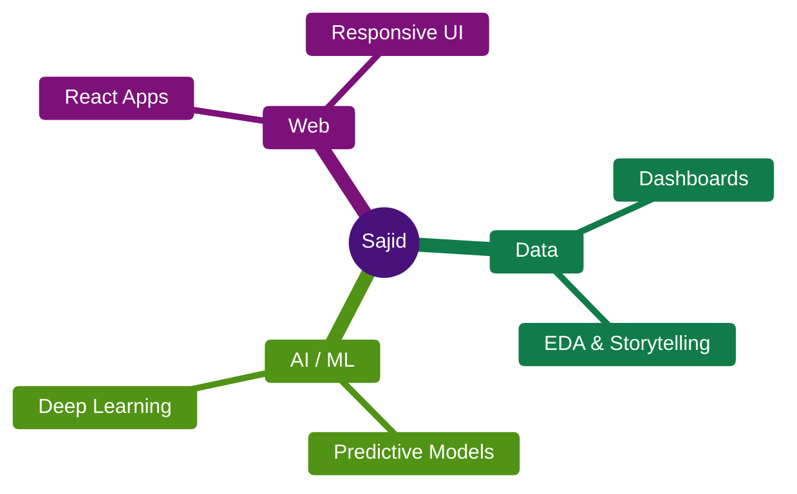

<!-- ═══════════════ HEADER ═══════════════ -->
<p align="center">
  
</p>

<h1 align="center">Hey there, I'm Sajid Mahmud 👋</h1>

<p align="center">
  
</p>

<p align="center">
  <a href="https://github.com/Sajidnihal52">
    
  </a>
  
  
  
</p>

<p align="center">
  
  
  
</p>

---

## 👨‍💻 About Me

```python
class SajidMahmud:
    def __init__(self):
        self.role      = "Junior Data Analyst @ Veecutech Solutions Sdn Bhd (Remote)"
        self.location  = "Bangladesh 🇧🇩"
        self.focus     = ["Data Analysis", "Machine Learning", "Web Development"]
        self.learning  = ["Deep Learning", "Data Storytelling", "Full-Stack Development"]
        self.mindset   = "Turn data into insights, ideas into applications."

    def say_hi(self):
        print("Thanks for stopping by! Let's build something great together 🚀")

Sajid = SajidMahmud()
Sajid.say_hi()
```

- 📊 Working as a **Junior Data Analyst** at Veecutech Solutions Sdn Bhd (Remote)
- 🤖 Passionate about **Artificial Intelligence** and **Machine Learning**
- 🌐 Developing **modern and responsive** web applications
- 📈 Turning raw data into **meaningful insights**
- 🚀 Continuously learning and building innovative projects

---

## 🛠️ Tech Stack

<p align="center">
  
</p>

<p align="center">
  
  
  
</p>

<details>
<summary><b>📚 Full toolbox (click to expand)</b></summary>
<br>

| Category | Tools |
|---|---|
| 🐍 **Languages** | Python · Java · JavaScript · SQL · HTML · CSS |
| 📊 **Data & Analytics** | Pandas · NumPy · Matplotlib · Seaborn · Excel |
| 🤖 **AI / ML** | Scikit-learn · Model Evaluation · Feature Engineering |
| 🌐 **Web** | React · Node.js · Responsive Design |
| 🗄️ **Databases** | MySQL |
| 🧰 **Tools** | Git · GitHub · VS Code · Jupyter |

</details>

---

## 📊 Skills at a Glance



---

## 🔄 How I Turn Data Into Insights



---

## 🧭 Growth Roadmap



---

## 🏆 GitHub Statistics

<p align="center">
  
  
</p>

<p align="center">
  
</p>

<p align="center">
  
</p>

---

## 📈 Contribution Activity

<p align="center">
  
</p>

---

## 🐍 Contribution Snake

<p align="center">
  <picture>
    <source media="(prefers-color-scheme: dark)" srcset="https://raw.githubusercontent.com/Sajidnihal52/Sajidnihal52/output/github-contribution-grid-snake-dark.svg">
    <source media="(prefers-color-scheme: light)" srcset="https://raw.githubusercontent.com/Sajidnihal52/Sajidnihal52/output/github-contribution-grid-snake.svg">
    
  </picture>
</p>

---

## 🌟 Featured Projects

| Area | What I Build |
|---|---|
| 🤖 **Machine Learning** | Predictive models and AI projects |
| 📊 **Data Analytics** | Data exploration, dashboards and visualization |
| 🌐 **Web Development** | Modern, responsive websites and web apps |


  PIN YOUR BEST REPOS: replace YOUR_REPO_NAME, then remove the comment markers.

<p align="center">
  <a href="https://github.com/Sajidnihal52/Underwater-Marine-Organism-Classification-and-Biodiversity-Monitoring">
    
  </a>
  <a href="https://github.com/Sajidnihal52/Underwater-Marine-Organism-Classification-and-Biodiversity-Monitoring">
    
  </a>
</p>


<p align="center">
  <a href="https://github.com/Sajidnihal52?tab=repositories">
    
  </a>
</p>

---

## 🎯 Currently Working On



---

## 🤝 Connect With Me

<p align="center">
  <a href="https://github.com/Sajidnihal52">
    
  </a>
  <!-- Add more links when ready, e.g.:
  <a href="https://www.linkedin.com/in/YOUR_ID"></a>
  <a href="mailto:you@example.com"></a>
  -->
</p>

<p align="center">
  <i>"Turning data into insights, ideas into applications, and challenges into opportunities."</i>
</p>

<p align="center">
  
</p>
